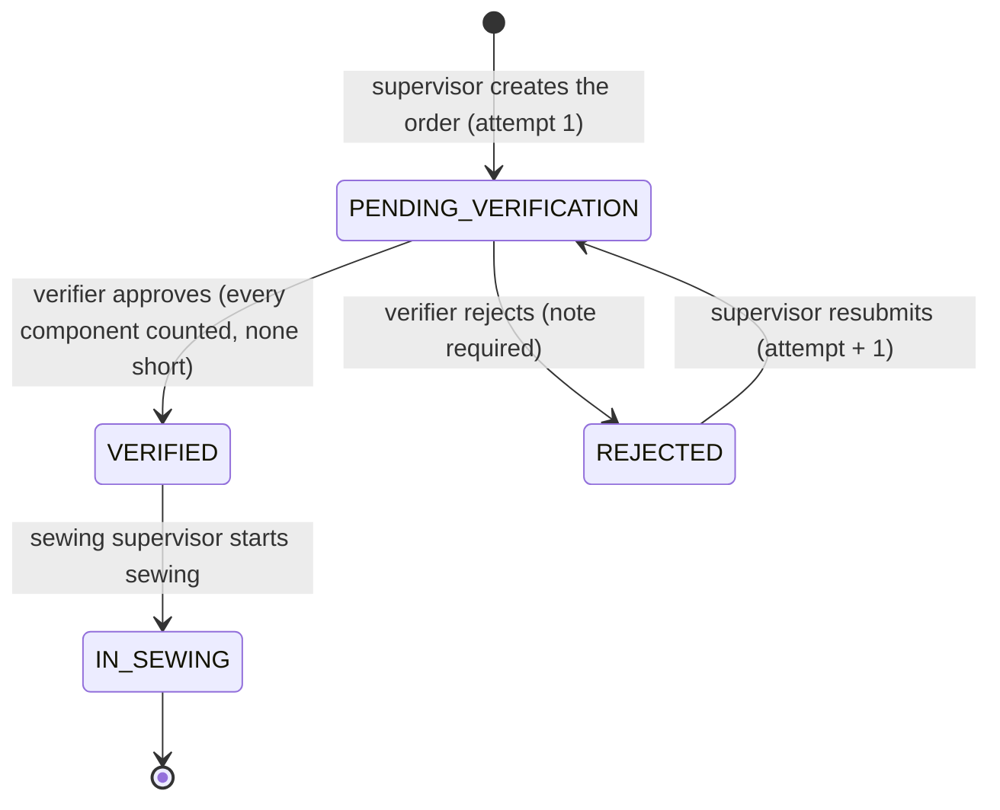
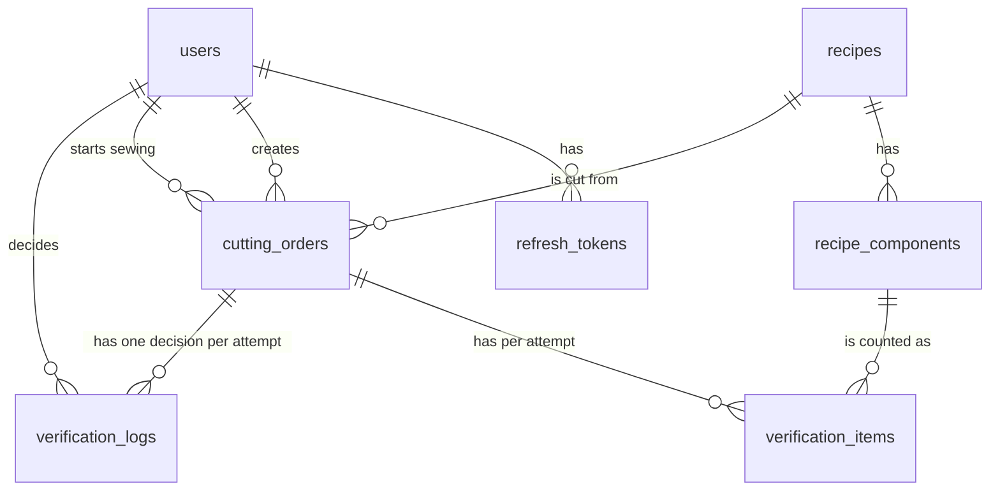

# ApparelFlow Cutting Gatekeeper

[](https://github.com/Nuwanthapasindu/apparelflow/actions/workflows/ci.yml)

A cutting-floor terminal for ApparelFlow ERP. A Cutting Supervisor creates a cutting order, a Cutting Verifier counts every component and signs it off, and only then can the batch reach the Sewing Supervisor's queue. The hard stop (no RED, missing or uncounted component can be approved) is enforced in the API **and** in PostgreSQL by triggers, not only in the UI. Built with Next.js 16 (App Router, Cache Components), React 19, TypeScript, Prisma 6, PostgreSQL on Supabase (used as plain Postgres), Zod, `jose`, Argon2id, Tailwind v4 and Vitest.

**Live URL:** [https://peaceful-bavarois-ee17c0.netlify.app/](https://peaceful-bavarois-ee17c0.netlify.app/)

**Run the tests** (needs Docker for the throwaway Postgres; it never touches the real database):

```bash
cp .env.test.example .env.test && yarn test:db:up && yarn test:db:migrate
yarn test
```

If `.env.test` is missing or the database is not running, `yarn test` stops at once and prints these same commands. The CI badge above shows the latest run on `main`.

## Evaluator quick path

Demo mode shows a **Role Switcher** (a dropdown in the header). It signs out and signs in again through the real login endpoint, so the server-side session genuinely changes; it never flips client state.

1. **Create an order.** Sign in as the Cutting Supervisor (credentials below). Click **New Cutting Order**, pick a recipe, enter a target quantity (for example `50`), a roll id and the fabric used (for example `91.00`), and click **Submit for verification**.
2. **The Verifier cannot create orders.** In the header open **Switch role** and choose **Cutting Verifier**. The order-creation button is not in the page at all (not hidden, absent from the DOM).
3. **A shortage blocks approval.** Open the batch from the queue. Type one fewer than the expected quantity in any row and click **Save counts**: that row turns red with **SHORTAGE** and **Approve Batch** is disabled with the reason beside it. Open the browser dev tools, remove the `disabled` attribute and click it, or send `POST /api/orders/<id>/approve` yourself: the server still answers **422** and names the short component.
4. **Approve a valid batch.** Correct the count, **Save counts**, click **Approve Batch**, then **Confirm approval**.
5. **Sewing sees only verified batches.** Choose **Sewing Supervisor** in **Switch role**. The approved batch is in **Ready for sewing**; any pending or rejected batch is absent (try `/api/sewing/queue?status=PENDING_VERIFICATION`: the parameter is ignored). Reload to see it persist, open the batch and click **Start Sewing Assembly** to move it to **In sewing**.

## Demo credentials

Public demo accounts with sample data only. Sign in on `/login`.

| Role | Email | Password | Can | Cannot |
|---|---|---|---|---|
| Cutting Supervisor | `cutting.supervisor@apparelflow.test` | `Demo-Supervisor-1` | Create orders, resubmit a rejected order | Count, approve or reject; see the Sewing Queue |
| Cutting Verifier | `cutting.verifier@apparelflow.test` | `Demo-Verifier-1` | Count components, approve, reject with a note | Create orders; see the Sewing Queue |
| Sewing Supervisor | `sewing.supervisor@apparelflow.test` | `Demo-Sewing-1` | See verified batches, start sewing | See pending, unverified or rejected orders |

The accounts and the two recipes (REC-BL01 Casual Blouse, REC-CT02 Crop Top) are created by `yarn prisma db seed`, which also resets the demo passwords to the values above. The Role Switcher appears only when `NEXT_PUBLIC_DEMO_MODE=true`.

## Architecture

**Request flow.** Every route is wrapped by `handle()` (`src/lib/api/handle.ts`). For a mutating request it checks the `Origin` header first (CSRF, on top of `SameSite=Lax`), then runs the handler in a fixed order: **authenticate (401) → role (403) → validate (400) → lock the order row and check scope or state (404 or 409) → business rules (422) → write**. Errors leave as `{ "error": { "code", "message", "fields?", "details?" } }`; database SQLSTATEs are mapped to clean codes and nothing else leaks.

- **Auth** (`src/lib/auth/`): a 15-minute HS256 access JWT in an HttpOnly cookie (only `sub`, `iat`, `exp`, `iss`, no role) and an opaque 7-day refresh token (cookie path `/api/auth`, stored only as a SHA-256 hash, rotated on every refresh; reuse of a rotated token revokes the whole family). `requireRole` re-reads the user and role from the database on every request. Passwords are hashed with Argon2id.
- **Services** (`src/lib/services/`): plain functions that take the authenticated user and re-assert the role. Every mutation runs in one transaction that locks the order row first (`SELECT ... FOR UPDATE`), so lock order is identical everywhere.
- **Domain** (`src/lib/domain/`): pure functions for expected quantity, traffic light (`evaluateCount`) and wastage (decimal arithmetic, rounded once). The server and the UI use the same functions.
- **UI** (`src/app`, `src/components`): light theme only; the session is read inside `<Suspense>` boundaries; navigation links come from the server-side role; sign out and role switching use a full page load so a shared terminal keeps no previous user's data.
- **Sewing queue.** One function, `listSewingQueue` (`src/lib/services/sewing-queue.ts`), holds the only status filter (`WHERE status = 'VERIFIED'`, a constant). The endpoint, the server-rendered `/sewing` page and brief Test 5 all call it, so the tested query is the shipped query. Query parameters other than `limit` are ignored.

## State machine



`CUTTING_IN_PROGRESS` exists in the enum to match the brief's diagram but is never used: a new order starts as `PENDING_VERIFICATION`. There is no transition out of `IN_SEWING`, and the database rejects any other transition.

## Schema



| Table | Purpose |
|---|---|
| `users` | Three roles (`cutting_supervisor`, `cutting_verifier`, `sewing_supervisor`), Argon2id hash, `is_active`. |
| `refresh_tokens` | Hashed rotating refresh tokens grouped by `family_id`, with `used_at` and `revoked_at` for reuse detection. |
| `recipes`, `recipe_components` | Seeded and read-only (no endpoint or screen edits them). Standard fabric yards, wastage cap, pieces per garment. |
| `cutting_orders` | One row per batch: recipe, target quantity, fabric roll, fabric used, `status`, `current_attempt`, who started sewing and when. |
| `verification_items` | One row per component and attempt. `component_name` and `expected_qty` are **snapshots** taken when the attempt starts; `actual_qty` and `status` stay `NULL` until counted. |
| `verification_logs` | The decision per attempt (`APPROVED` or `REJECTED`, unique per order and attempt), the verifier, the server timestamp, the rejection note, and on approval the fabric snapshot (expected and actual yards, wastage %, cap, `over_cap`). **Append-only.** |

Snapshots are deliberate: editing a recipe later never changes history. A rejected attempt keeps its item rows and log, and a resubmit creates new item rows with the next `attempt_no`. Row level security is enabled on all seven tables with no policies, and the app reaches Postgres only through Prisma (the Supabase Data API is not used).

## Where each rule is enforced

| Rule | API check | Database check | UI hint |
|---|---|---|---|
| A RED, missing or uncounted component blocks approval | `approveOrder` recomputes from the stored quantities (never the stored status) and answers 422 with `details.blocking` | `gk_log_insert_guard` refuses an `APPROVED` log unless every component of the order's recipe has a counted, non-short item | Approve Batch is `disabled` with a visible reason |
| Only the verifier approves or rejects | `requireRole` (403) plus the service re-checks the role | the log guard requires an active `cutting_verifier` | the buttons exist only in the Verifier Terminal |
| A rejection needs a note | Zod: trimmed, 1 to 1000 characters, no NUL or invisible-only text (400) | `chk_logs_reject_note` requires a visible character | inline error in the dialog |
| Legal status transitions only | state check under the row lock (409) | `trg_order_update_guard` allows only the four transitions; `VERIFIED` needs an `APPROVED` log for the current attempt | actions appear only in the right state |
| Verifier id, timestamps, item status, wastage and over-cap are server values | strict schemas reject those keys (400); values come from the session, the database clock and `calculateWastage` | check constraint ties item status to the quantities; `timestamp` defaults to the database clock | none, the client cannot send them |
| One decision per attempt, even under a race | row lock makes the second request a 409 | `UNIQUE (order_id, attempt_no)` | confirmation dialogs disable while in flight |
| The audit trail is append-only | no endpoint updates or deletes a log | `trg_logs_immutable` blocks `UPDATE` and `DELETE`; `trg_items_frozen_after_decision` freezes the items of a decided attempt | none |
| The batch definition never changes | there is no edit endpoint | `trg_order_update_guard` freezes recipe, quantity, roll, number and creator (fabric yards only while `REJECTED`) | none |
| Sewing sees only verified batches | `WHERE status = 'VERIFIED'` is a constant in one function; any other order is a 404 | `VERIFIED` is unreachable without an approval | pending and rejected batches are absent from the page |
| Start Sewing is a guarded transition | `UPDATE ... WHERE status = 'VERIFIED'` must change exactly one row (409 otherwise); starter and time come from the session and database clock | the update guard requires an active `sewing_supervisor` and blocks `IN_SEWING` going back | confirmation dialog, action disappears afterwards |

## API reference

All bodies are JSON. Every mutating request is subject to the `Origin` check (403 `CSRF_ORIGIN` for a foreign origin). Unauthenticated is 401 and a wrong role is 403 on every protected endpoint.

| Endpoint | Role | Success | Other errors |
|---|---|---|---|
| `POST /api/auth/login` | public | 200, sets cookies | 400, 401 |
| `POST /api/auth/refresh` | refresh cookie | 200, rotates cookies | 401 |
| `POST /api/auth/logout` | any | 200 (idempotent) | |
| `GET /api/me` | any signed-in user | 200 | |
| `GET /api/recipes` | supervisor | 200 | |
| `POST /api/orders` | supervisor | 201 | 400 |
| `GET /api/orders?status=&limit=` | supervisor (all); verifier (pending only, `status` for anything else is 403) | 200 | 400 |
| `GET /api/orders/:id` | supervisor; verifier (pending only, otherwise 404) | 200 | 404 |
| `PUT /api/orders/:id/counts` | verifier | 200 | 400, 404, 409 |
| `POST /api/orders/:id/approve` | verifier | 200 | 400, 404, 409, **422** |
| `POST /api/orders/:id/reject` | verifier | 200 | 400, 404, 409 |
| `POST /api/orders/:id/resubmit` | supervisor | 200 | 400, 404, 409 |
| `GET /api/sewing/queue?limit=` | sewing supervisor | 200, `VERIFIED` only | 400 |
| `GET /api/sewing/active?limit=` | sewing supervisor | 200, `IN_SEWING` only | 400 |
| `GET /api/sewing/:id` | sewing supervisor | 200 for `VERIFIED` or `IN_SEWING` | 404 |
| `POST /api/sewing/:id/start` | sewing supervisor | 200 | 400, 404, 409 |

Status codes: 400 malformed or invalid input (including a blank rejection note and decimal piece counts); 401 no session; 403 wrong role; 404 not found or out of scope; 409 illegal state or already decided; 422 business-rule violation (a RED, missing or uncounted component).

## Running locally and tests

```bash
yarn install                        # also runs prisma generate
# create .env with DATABASE_URL, DIRECT_URL, JWT_SECRET (32+ chars), NEXT_PUBLIC_DEMO_MODE=true (names in .env.example)
yarn prisma migrate deploy && yarn prisma db seed
yarn dev                            # http://localhost:3000
```

Tests run against a throwaway Postgres on `localhost:5433`, never the real database (the runner refuses any URL that is not local with a name containing `test`). Two commands start and migrate it:

```bash
cp .env.test.example .env.test      # localhost-only test values
yarn test:db:up                     # Postgres 16 from docker-compose.test.yml
yarn test:db:migrate
yarn test                           # Vitest: DB triggers, API route handlers, domain and client logic
```

`yarn e2e` runs the Playwright specs in `tests/e2e` (the evaluator path and automated contrast checks) against a production build and a freshly migrated and seeded test database. Install a browser once with `npx playwright install chromium`, or use the Chrome already on your machine with `PW_CHANNEL=chrome yarn e2e`. Setting `BASE_URL=https://your-app` drives a deployment instead; that **creates data** there. The native `<option>` popup of a `<select>` cannot be measured automatically and remains a manual contrast check.

GitHub Actions (`.github/workflows/ci.yml`) runs lint, the Prisma schema check, type-check, the migrations, the Vitest suite and the production build against a Postgres 16 service on every push and pull request to `main` and `dev`.

## Deployment and migrations

- Set `DATABASE_URL` (Supabase transaction pooler, port 6543, `?pgbouncer=true`), `DIRECT_URL` (session pooler, port 5432), `JWT_SECRET` (32 or more random characters) and `NEXT_PUBLIC_DEMO_MODE=true` in Vercel. Choose the Vercel region closest to the Supabase region.
- Migrations are **not** run by the Vercel build. Apply them by hand from a developer machine before deploying: `yarn prisma migrate deploy` (it uses `DIRECT_URL`). `postinstall` runs `prisma generate` so the git-ignored client exists on Vercel.
- Next's file tracing includes the Linux Prisma engine in every server route (`outputFileTracingIncludes`), and `src/lib/db.ts` copies it to `/tmp/prisma-engines` on a cold start, because the bundler rewrites the generated client's directory to a path that does not exist in a serverless function. The generator lists `rhel-openssl-3.0.x` in `binaryTargets`.
- A free-tier Supabase project can pause when inactive: open its dashboard before using the live demo.
- Orders created while testing stay in the database; remove them in the Supabase SQL editor if you want a clean board.

## Deliberate interpretations

- **`IN_SEWING` and a separate active list.** "Start Sewing Assembly" has a real, persistent effect: the order becomes `IN_SEWING`, recording who and when from the session and the database clock. The queue stays a literal `WHERE status = 'VERIFIED'`; started batches are listed by `GET /api/sewing/active`.
- **Wastage over the cap is a flag, not a block.** An over-cap batch shows an amber **OVER CAP** badge and still approves. The hard stop is a RED, missing or uncounted component, and the cap, expected fabric and `over_cap` are snapshotted on the approval log.
- **Integer counts, two-decimal fabric.** Piece counts and target quantities are whole numbers. Fabric yards are a measurement: greater than zero, at most two decimal places, validated as text and never parsed with `Number()` first.
- **400 versus 422.** Malformed or invalid input (a blank note, a decimal count) is 400; a well-formed approval that breaks a business rule (a shortage) is 422.
- **Resubmit on the same order.** A rejected order goes back to the supervisor and is resubmitted as the same order with the next attempt number; each attempt keeps its own item rows and decision.
- **Fabric is not updated on resubmit.** Resubmit creates a new count attempt but accepts no new fabric figure, so extra fabric used by a re-cut is not tracked in this version.
- **`CUTTING_IN_PROGRESS` is unused.** It exists only to match the brief's diagram; there is no draft state.
- **"Verifier audit notes" means the audit trail block.** The sewing detail shows who approved, when, the counts, variances, wastage and the over-cap flag. The schema has no free-text approval remark, and none was added.
- **404 for out-of-scope orders.** The sewing role gets 404, not 403, for a pending, rejected or unknown order, and a verifier gets 404 for a non-pending order, so existence is not revealed. A wrong role is always 403 first.
- **Sewing sees only the approved attempt.** After a re-cut, sewing sees attempt 2's counts and the attempt number, never the rejection note or the earlier attempt.

## Known limitations

- No rate limiting or lockout on login.
- An unknown email is rejected faster than a wrong password for a known email (no dummy hash comparison), so account existence can be inferred from timing.
- Logging out revokes the refresh token at once, but an access token already issued stays valid for up to 15 minutes.
- Refresh tokens slide for 7 days with no absolute lifetime cap, and expired token rows are not cleaned up.
- Two browser tabs refreshing at the very same moment can sign the user out (the second use of a rotated token counts as reuse).
- Creating an order has no idempotency key; the UI blocks double submits, but a client that retries after a timeout can create a second order.
- The lists have a `limit` of up to 100 and no paging controls.
- A stale verifier tab from an earlier attempt can save counts onto a resubmitted attempt (approval still judges the stored counts under a lock, so the hard stop holds).
- The Prisma transaction time limit is the default; under extreme contention a waiting request fails with a generic 500 instead of a 409.
- A free-tier database may pause, and the tests need a local Postgres (see above).
